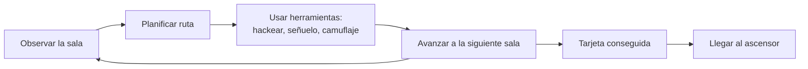

# Circuito Silencioso - Documento de diseño (GDD)

> Título provisional.

## 1. Ficha del juego

| | |
|---|---|
| Título | Circuito Silencioso (provisional) |
| Autor | Borja Abal Dios |
| Género | Sigilo / puzles de acción |
| 2D / 3D | 3D, vista isométrica |
| Plataformas | Windows (opcional: Web) |
| Versión de Unity y pipeline | Unity 6 - URP (plantilla Universal 3D) |
| Público objetivo y PEGI | Jugadores casuales y aficionados al sigilo y los puzles. PEGI 7 (violencia nula; el jugador nunca ataca) |
| Duración de una partida | 20-30 minutos (unos 7-10 minutos por nivel) |
| Repositorio | [github.com/borja200/Proyecto-Unity](https://github.com/borja200/Proyecto-Unity) |
| Página de itch.io | *(pendiente)* |

## 2. Concepto

### Resumen

Un juego de sigilo en 3D isométrico en el que controlas a un pequeño dron infiltrado que debe robar la tarjeta de acceso de cada planta de un edificio corporativo y llegar al ascensor sin que lo detecten las cámaras ni los robots de seguridad.

### Pilares de diseño

1. **Ver y ser visto**: toda la información de detección es visible y fiable. Los conos de visión que se dibujan son exactamente los que detectan, así que si te pillan es por tu culpa, no por el juego.
2. **Planificar antes de actuar**: cada habitación es un pequeño puzle que se resuelve observando las patrullas y eligiendo el momento.
3. **Herramientas que se combinan**: ninguna mecánica resuelve una sala por sí sola; la gracia está en encadenarlas (señuelo + hackeo, camuflaje + conducto...).
4. **Cada planta enseña algo nuevo**: cada nivel introduce una amenaza o herramienta nueva en una situación segura antes de exigirla en una difícil.

### Referencias

- ***Lara Croft GO* / *Hitman GO***: niveles pequeños tipo diorama que se leen de un vistazo y cámara isométrica fija.
- ***Metal Gear Solid* (vista cenital)**: conos de visión, guardias que investigan ruidos y estado de alerta.
- ***Mark of the Ninja***: información de sigilo siempre visible (ondas de sonido, conos de visión) y el uso del ruido como herramienta.
- ***Monaco***: sensación de "golpe" con un objetivo claro y una huida contrarreloj.

### Qué lo hace diferente

El protagonista es un dron: no puede atacar ni noquear a nadie, solo esquivar, engañar y hackear. El sigilo es la única opción, no una alternativa al combate. Además, el camuflaje óptico depende de una batería, un recurso que obliga a decidir cuándo esconderse y cuándo arriesgarse.

## 3. Historia y ambientación

**Premisa**: en un futuro cercano, la corporación Helix guarda en la bóveda de su sede un núcleo de datos con pruebas de sus experimentos ilegales. Un grupo de hackers introduce en el edificio un pequeño dron de mantenimiento reprogramado para robarlo.

**Protagonista**: el dron, apodado **"Chispa"** por el grupo. Su objetivo es subir planta a planta, desde la recepción hasta la bóveda, robar el núcleo de datos y escapar antes de que el edificio se cierre.

**Cómo se cuenta la historia**: con mensajes breves por radio del grupo de hackers al inicio y al final de cada nivel (cuadros de texto en el HUD) y con el propio escenario. El edificio se vuelve más frío y vigilado cuanto más alto subes. No hay cinemáticas.

**Ambientación**: oficinas y laboratorios corporativos limpios, de colores fríos, con iluminación artificial. La sensación buscada es la de tensión contenida: silencio, zumbido de máquinas y el paso mecánico de los robots de seguridad.

## 4. Jugabilidad

### Objetivo

En cada nivel: encontrar y recoger la **tarjeta de acceso** y llegar al **ascensor** sin ser detectado. En el último nivel la tarjeta se sustituye por el **núcleo de datos**, y tras recogerlo hay que llegar al ascensor antes de que termine la cuenta atrás.

### Bucle de juego

*Observar → planificar → actuar con las herramientas → avanzar → repetir hasta conseguir la tarjeta y llegar al ascensor.*

### Condiciones de victoria y derrota

- **Victoria de nivel**: entrar en el ascensor con la tarjeta (o el núcleo) en tu poder. Se pasa al siguiente nivel.
- **Victoria del juego**: completar el nivel 3. Se muestra la pantalla de victoria y después los créditos.
- **Derrota**:
  - El **medidor de detección** de una cámara o un guardia se llena por completo (te han visto).
  - En el nivel 3, la **cuenta atrás** de la alarma llega a cero.
- Tras perder aparece la pantalla de derrota, con las opciones de reintentar el nivel o volver al menú principal.

### Progresión

- La dificultad sube planta a planta: primero amenazas estáticas (cámaras), después móviles (robots de patrulla) y por último una presión de tiempo (cuenta atrás).
- Cada mecánica se presenta primero en una sala segura, sin riesgo de detección, y se exige después en salas con vigilancia.
- Al avanzar, el jugador consigue nuevas herramientas: los señuelos en el nivel 2 y el acceso a los conductos.
- Contenido opcional: en cada nivel hay **archivos de datos** escondidos (coleccionables) y se guarda el mejor tiempo y el número de detecciones evitadas.

## 5. Mecánicas

| Mecánica | Descripción | Control | Nivel en el que aparece |
|----------|-------------|---------|-------------------------|
| Hackear terminales | Manteniendo pulsada la tecla junto a un terminal durante 1,5 s, se desactiva una cámara de seguridad durante 8 s o se abre una puerta durante 10 s. Si te alejas, el hackeo se cancela. | Mantener `E` / botón `X` | 1 |
| Recoger objetos | Al pasar por encima se recoge la tarjeta de acceso (necesaria para el ascensor), las baterías (recargan el camuflaje) y los archivos de datos (coleccionables). | Automático | 1 |
| Camuflaje óptico | El dron se vuelve invisible para cámaras y guardias mientras esté quieto. Consume 25 puntos de batería por segundo (máximo 100, unos 4 s). Moverse o agotar la batería lo cancela. | Mantener `Q` / botón `B` | 1 |
| Lanzar señuelos | Se lanza un dispositivo con físicas 3D que hace ruido al chocar. Los guardias que lo oyen dentro de su radio dejan la patrulla y van a investigar. Hay un número limitado por nivel (3 iniciales; se pueden recoger más). | Apuntar con el ratón + clic izquierdo / gatillo derecho | 2 |
| Conductos de ventilación | Rejillas por las que el dron entra y sale en otro punto de la sala o en otra sala. Dentro de un conducto es indetectable. | `E` / botón `X` junto a la rejilla | 2 |
| Láseres de seguridad | Barreras que activan la detección al atravesarlas. Algunas se pueden desactivar desde un terminal; otras se encienden y apagan con un ciclo fijo. | — (obstáculo) | 2 |
| Suelo ruidoso | Placas metálicas que hacen ruido al cruzarlas a velocidad normal y atraen a los guardias. Se pueden cruzar en silencio moviéndose despacio. | Mantener `Shift` / gatillo izquierdo (moverse despacio) | 3 |

**Cómo se combinan:**

- **Señuelo + hackeo**: se lanza un señuelo para alejar a un guardia de un terminal y hackearlo mientras no mira.
- **Hackeo + camuflaje**: si un guardia se acerca mientras hackeas, el camuflaje te mantiene oculto. Pero no puedes moverte, así que hay que elegir bien el sitio.
- **Conductos + señuelos**: un señuelo lanzado nada más salir de un conducto crea la distracción justo donde la necesitas.
- **Suelo ruidoso como señuelo**: en el nivel 3, el ruido de las placas puede usarse a propósito para atraer a un guardia y despejar otra zona.
- **Cuenta atrás + todo lo anterior**: en la huida del nivel 3, moverse despacio o esperar a que la batería se recargue cuesta tiempo, así que el jugador tiene que arriesgar.

**Detección:**

- Las cámaras y los guardias tienen un **cono de visión** (ángulo + distancia + raycast para que las paredes bloqueen la vista). Se representa con una luz Spot que usa *exactamente* los mismos valores.
- Dentro del cono se llena un **medidor de detección**, más rápido cuanto más cerca está el dron. Fuera del cono se vacía poco a poco. Si se llena, el jugador pierde.
- Valores iniciales (se ajustarán en las pruebas): velocidad del dron 4 m/s (2 m/s en modo silencioso), cono de cámara de 60° y 8 m, cono de guardia de 70° y 10 m, radio de audición del señuelo de 7 m.

**Comportamiento de los guardias (máquina de estados):**

`Patrulla` → (oye ruido) → `Investigar` (va al punto del ruido con NavMesh y mira alrededor) → (no encuentra nada) → `Volver a patrulla`.
Desde cualquier estado → (ve al dron) → `Alerta` (se llena el medidor y el guardia se gira hacia él) → (el medidor se llena) → derrota; (el dron escapa) → `Investigar` en su última posición conocida.

